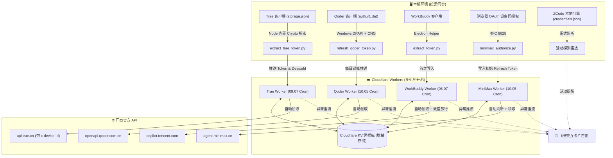

# AI Token Checkin Workers

<div align="center">

**国内主流 AI 编程助手每日额度自动签到套件（Cloudflare Worker Serverless 版）**

*电脑关机也能准时打卡 · 自动令牌轮换 · 飞书告警卡片 · 零第三方依赖 · 5大平台全矩阵*

[](LICENSE)
[](https://workers.cloudflare.com/)
[](https://www.python.org/)
[](https://nodejs.org/)

[快速开始](#-快速开始) • [平台矩阵](#-支持平台与特性) • [收益测算](#-年度算力收益测算) • [飞书通知](#-飞书智能交互卡片告警) • [一键巡检](#-一键状态巡检) • [架构解析](docs/ARCHITECTURE.md) • [免责声明](#-免责声明-disclaimer)

</div>

---

### 💡 年度算力收益测算

> 每天只需花费 0 元成本，将自动化打卡 Worker 免费托管在 Cloudflare 边缘计算上：
> 
> * **MiniMax Code (海螺)**：每日自动领 **400 算力**（全年累积 **146,000 算力**）
> * **Trae CN (字节跳动)**：每日自动领 **100 积分**（全年累积 **36,500 积分**）
> * **WorkBuddy (腾讯)**：每日自动领 **100 积分 + 连签成长值 + 自动派猫旅行领特产**（全年累积 **36,500+ 积分**）
> * **Qoder CN**：每日自动领 **100 Credits**（滚动轮换，额度永续）
> * **ZCode (智谱清言)**：本地 CLI 引擎就绪守护 + 官方限时活动雷达监听
> 
> 💰 **折合价值**：全年相当于免费获取价值超过 **¥1,200+** 的商业级高阶代码生成与大模型推理额度！

---

## ⚠️ 免责声明 (Disclaimer)

> **本项目仅供网络协议交互分析、个人学习研究及学术交流使用。**
> 1. 本项目代码绕过客户端图形界面调用签到接口，使用自动化脚本代签属于平台服务协议中的灰色地带；
> 2. 使用者在部署和运行本项目前，应充分阅读并遵守各 AI 服务提供商的服务条款与用户协议；
> 3. 任何因直接或间接使用本项目代码而导致的积分扣减、账号风控或限制，均由使用者自行承担；
> 4. **严禁将本项目用于任何形式的商业盈利行为或多账号批量恶意刷量**。

---

## 🌟 支持平台与特性

| 平台 | 每日收益 | 定时触发 (北京时间) | 令牌机制 | 运行架构与进阶能力 |
| :--- | :--- | :--- | :--- | :--- |
| **WorkBuddy**<br>(腾讯加油站) | 100 积分 + 连签成长值<br>+ 旅行特产奖励 | **08:07** | 30 天超长 Access Token 缓存 | 完全云端自洽，防桌面端抢占下线；**自动派遣萌猫旅行出发与领取特产** |
| **Trae CN**<br>(字节 Trae IDE) | 100 积分 | **09:07** | 本地 AES-128 解密<br>+ `x-device-id` 绑定 | 本地轻量提取一次 + 云端准时自动打卡，完美穿透风控 |
| **MiniMax Code**<br>(海螺 AI) | 每日 400 算力<br>(首日赠 1024) | **10:05** | RFC 8628 OAuth 2.0<br>设备授权 | 自动轮换 Refresh Token，完全云端闭环，一次授权终生代领 |
| **Qoder CN**<br>(Qoder 助手) | 100 Credits<br>(30天有效期) | **10:05** | 原生 Windows DPAPI+CNG<br>解密 (~16天) | 错峰本地续期 + 云端 16 天无感容灾打卡 |
| **ZCode**<br>(智谱清言) | 限时活动额度<br>+ CLI 生态 | 随活动触发 | 本地官方 CLI 凭证校验 | 本地环境状态守护 + 飞书活动雷达实时探测推送 |

---

## 🚨 飞书智能交互卡片告警

项目支持接入飞书机器人（支持 Webhook 或企业自建应用 App Secret），遵循**「静默打卡 + 异常红牌告警」**原则：

- **日常运行**：代领成功静默入库，不打扰工作；
- **异常熔断**：一旦发生 Token 过期、设备码失效或上游接口变动，立即向飞书群/私聊推送**高优先级交互卡片**，附带故障诊断与一键修复指引；
- **连通性测试**：各 Worker 均内置 `GET /test-notify?key=...` 接口，部署后可秒级验证通知通道。

```text
┌──────────────────────────────────────────────┐
│  🚨 MiniMax Code 自动签到失败告警             │
├──────────────────────────────────────────────┤
│  平台：MiniMax Code (海螺)                     │
│  时间：2026-11-03 10:05:34                    │
│  错误：OAuth refresh token expired           │
│  建议：请运行 scripts/minimax_authorize.py 重新授权 │
└──────────────────────────────────────────────┘
```

---

## 🏗️ 架构概览



---

## 🚀 快速开始

### 1. 前置准备
- 一个免费的 [Cloudflare 账号](https://dash.cloudflare.com/)；
- 本地安装 Node.js 18+ 与 Python 3.8+；
- 全局安装 Wrangler CLI：
  ```bash
  npm install -g wrangler
  wrangler login
  ```

### 2. 部署各平台 Worker（以 MiniMax 为例）
```bash
cd workers/minimax-code

# 1. 创建 KV 命名空间
npx wrangler kv namespace create MM
# 将输出的 id 复制填入 wrangler.toml
cp wrangler.toml.example wrangler.toml

# 2. 设置安全管理密钥
npx wrangler secret put ADMIN_KEY

# 3. 部署至边缘节点
npx wrangler deploy

# 4. 浏览器一次性授权并推送到 Worker
python scripts/minimax_authorize.py \
  --worker https://your-minimax-worker.workers.dev \
  --key YOUR_ADMIN_KEY
```

> 其余平台部署步骤完全一致，详见各目录下的独立文档：
> - [MiniMax Code 部署手册](workers/minimax-code/README.md)
> - [Trae CN 部署手册](workers/trae-cn/README.md)
> - [Qoder CN 部署手册](workers/qoder-cn/README.md)
> - [WorkBuddy 部署手册](workers/workbuddy/README.md)

---

## 🔍 一键状态巡检

配置根目录下的 `.env` 文件：
```bash
cp .env.example .env
# 编辑 .env 填入您部署的 Worker 地址、管理密钥及可选代理
```

提供三种巡检方式，任选其一：

- **跨平台 Python 原生（推荐）**：
  ```bash
  python check_all.py
  ```
- **Windows PowerShell 原生**：
  ```powershell
  .\check-all.ps1
  ```
- **Linux / macOS / Git Bash**：
  ```bash
  bash check-all.sh
  ```

终端输出示例：
```text
=== 五平台 AI 签到与活动雷达巡检 ===
  巡检时间：2026-11-03 09:05:24 UTC / 2026-11-03 17:05:24 北京时间

  WorkBuddy      成功         already-checked-in    连签=32天 (2026-11-03 08:07:11)
  Trae CN        成功         claimed +100          积分=100 (2026-11-03 09:07:25)
  MiniMax Code   成功         claimed +400          积分=400 (2026-11-03 10:05:34)
  Qoder CN       成功         already-claimed       (2026-11-03 14:50:18)
  ZCode          成功         CLI v0.17.1 就绪       BigModel Coding Plan | 飞书活动雷达守护中
```

---

## 📂 项目结构

```text
ai-token-checkin-workers/
├── .github/workflows/ci.yml       # 语法校验与结构自动化测试
├── common/
│   └── proxy_util.py              # Clash/Mihomo 端口智能探测与回退重试
├── docs/
│   ├── ARCHITECTURE.md            # 各平台令牌机制与生命周期深度剖析
│   └── FAQ_TROUBLESHOOTING.md     # 错误代码速查手册
├── workers/
│   ├── minimax-code/              # MiniMax Code 云端自洽签到 Worker
│   ├── trae-cn/                   # Trae CN 逆向解密与设备验证 Worker
│   ├── qoder-cn/                  # Qoder CN 零依赖解密与 16 天容灾 Worker
│   └── workbuddy/                 # WorkBuddy 30 天抗抢占缓存 + 自动旅行 Worker
├── check_all.py                   # 跨平台 Python 一键巡检
├── check-all.ps1                  # Windows PowerShell 原生巡检
├── check-all.sh                   # Linux/macOS Shell 巡检
├── .env.example                   # 环境变量模板
└── LICENSE                        # 包含免责条款的 MIT 许可证
```

---

## 📜 许可证

本项目基于 [MIT 许可证](LICENSE) 发布。欢迎提交 PR、Issue 或分享交流。
